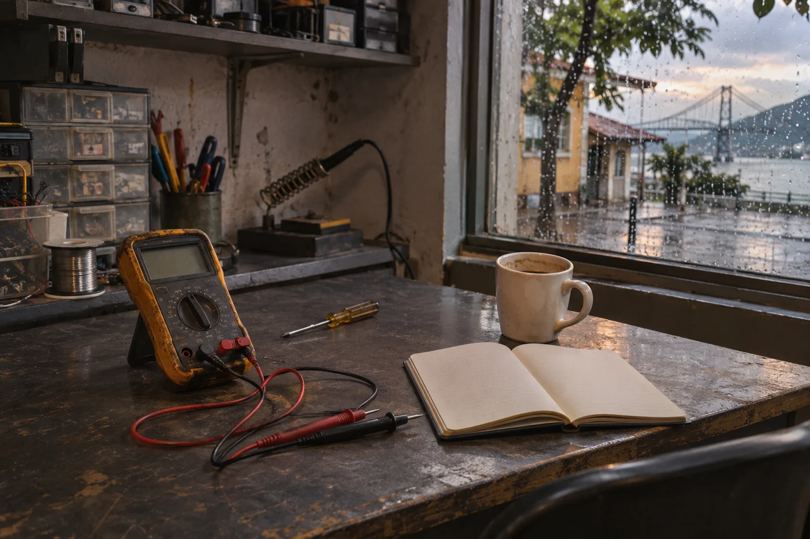

# Depois da chuva — Natural ou Fake Natty?

## 📒 Descrição

Uma bancada de eletrônica fictícia em Florianópolis, vista no fim de uma tarde chuvosa. O projeto explora como luz, desgaste e objetos comuns podem dar a uma imagem gerada por IA a aparência de uma fotografia documental.

## 🤖 Tecnologias Utilizadas

- **ChatGPT** para desenvolver o conceito, escrever o prompt e revisar a cena.
- **Gerador de imagens do ChatGPT** para sintetizar a imagem.
- **Pillow** para exportar a imagem em WebP.
- **GitHub** para publicar o projeto e registrar o processo.

## 🧐 Processo de Criação

1. Escolhi um cenário cotidiano e especifiquei poucos objetos com função clara. Um multímetro, pontas de prova, um caderno e uma caneca ajudam a contar a história de uma oficina em uso.
2. Pedi luz lateral suave, gotículas na janela e texturas desgastadas. Usei o enquadramento à altura de quem está sentado para aproximar a imagem de uma foto feita durante o trabalho.
3. Revisei a relação entre a luz da janela, o brilho na bancada e a disposição dos cabos. Exportei a imagem final em 1440 × 960 pixels para facilitar a visualização no GitHub.

[Ver o prompt completo e a ficha técnica](./prompts.md)

## 🚀 Resultados

**Revelação:** a cena foi gerada por IA. O local retratado é fictício.

Antes de abrir a ficha, observe a janela, as sombras sob a caneca e a trajetória dos fios. Qual detalhe mais convenceu você?

## 💭 Reflexão

A cena parece vivida porque combina pequenos sinais de uso, como a borda gasta da bancada e a marca de café na caneca. Ao ampliar, vale seguir os cabos até cada conector e observar as marcações do multímetro. Esses detalhes pedem mais cuidado numa imagem de uso técnico. Em uma peça editorial, a identificação da origem ajuda o leitor a interpretar a cena corretamente.

[Desafio original da DIO](https://github.com/digitalinnovationone/lab-natty-or-not) · **#LabDIONattyOrNot**
